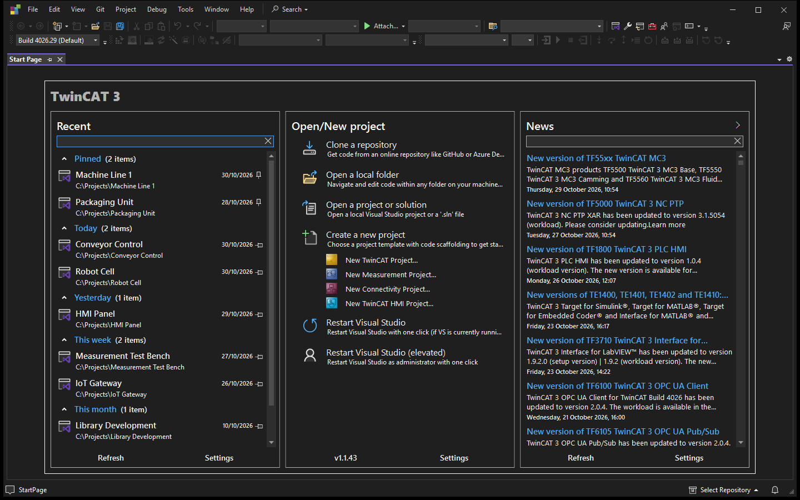
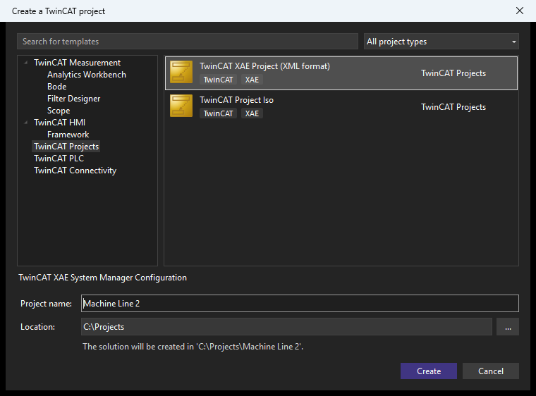
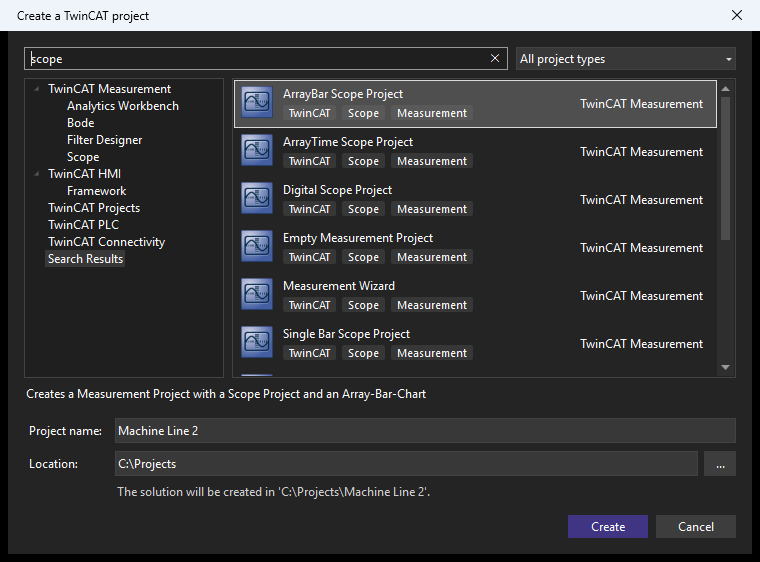
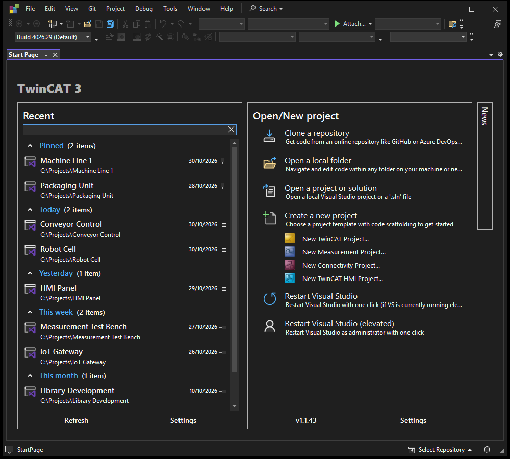
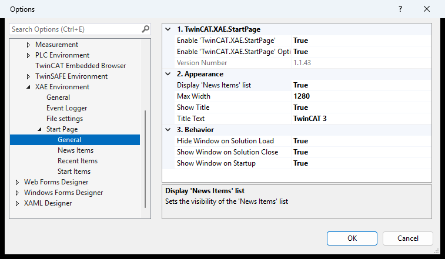

# TwinCAT Start Page

A start page extension for the **TwinCAT XAE Shell (64-bit)** and **Visual Studio 2022 / 2026**.
It brings back the classic start page as a document tab, the way TwinCAT 3 used to have it.
The tab shows recent projects, open and create actions, and the Beckhoff TwinCAT news.

**Repository:** https://github.com/HA-Freak/TwinCAT-Start-Page · [Releases](https://github.com/HA-Freak/TwinCAT-Start-Page/releases) · [Issues](https://github.com/HA-Freak/TwinCAT-Start-Page/issues)

It is based on [Start Page+ (64-bit)](https://github.com/yannduran/start-page-plus-64-bit) by Yann Duran / Luminous Software Solutions (MIT license). This version adds TwinCAT-specific features and TcPkg packaging.



---

## Contents

- [Features](#features)
- [Installation](#installation)
- [Usage](#usage)
- [Options](#options)
- [Building from source](#building-from-source)
- [Repository layout](#repository-layout)
- [Troubleshooting](#troubleshooting)
- [License](#license)

---

## Features

### Recent Items
- Recently opened solutions, projects and folders, grouped by date (*Today*, *Yesterday*, *This Week*, …).
- Pin items to keep them at the top, remove items from the list, and copy their paths.
- A live filter to find an item quickly.

### Open / New Project
| Item | Action |
|---|---|
| **Clone a repository** | Opens the shell's clone dialog |
| **Open a local folder** | Opens a folder without a solution |
| **Open a project or solution** | Opens an existing `.sln` or project file |
| **Create a new project** | Opens the shell's own *Create a new project* dialog |
| ↳ **New TwinCAT Project...** | Opens the *Create a TwinCAT project* dialog on *TwinCAT Projects* |
| ↳ **New Measurement Project...** | Opens it on *TwinCAT Measurement* |
| ↳ **New Connectivity Project...** | Opens it on *TwinCAT Connectivity* |
| ↳ **New TwinCAT HMI Project...** | Opens it on *TwinCAT HMI* |
| **Restart Visual Studio** | Restarts the shell; an elevated shell stays elevated |
| **Restart Visual Studio (elevated)** | Restarts the shell as administrator |

The *New … Project...* links appear only for products whose templates are installed.

### Create a TwinCAT project dialog
A dialog in the style of the shell's legacy *New Project* dialog:



- **Category tree:** the same structure the shell uses, e.g. *TwinCAT Measurement › Bode*, *TwinCAT PLC*, *TwinCAT Projects*, *TwinCAT Connectivity*.
- **Search:** searches template names, descriptions, categories and tags, and shows the matches under a *Search Results* node. Every word must match.
- **Type filter:** shows only templates of one project type.
- **Template sources:** the dialog finds the templates by itself:
  - TwinCAT's own templates in `<InstallDir>\Components\Base\PrjTemplate` and `PlcTemplate`. This includes your own `*.tsproj` / `*.tspproj` files placed there.
  - Project templates from installed extensions (Measurement, Connectivity, HMI, IoT functions, …). These are read from each extension's `extension.vsixmanifest` and `.vstman` manifests, filtered on the `TwinCAT` platform tag.
  
- **Name and location:** suggests a free project name. The location defaults to the setting below, or to the shell's projects folder. The result is `Location\Name\Name.sln`, with the project in `Location\Name\Name\`.

The TwinCAT install directory is read from
`HKLM\SOFTWARE\WOW6432Node\Beckhoff\TwinCAT3\3.1\InstallDir`.

### News
- The Beckhoff TwinCAT RSS feed, with a live filter.
- Links open inside the shell (WebView2) or in your default browser.
- **Minimizable:** the **›** button next to the heading shrinks the column to a vertical **News** tab at the right edge. Click the tab to expand it again. The state is remembered.
- **Automatic minimizing:** when the start page is too narrow (less than ~320 px per column), the News column minimizes by itself and expands again when there is room. This does not change the state you set yourself.



---

## Installation

### With TcPkg (recommended)

The extension is published as TcPkg packages and is listed as a **workload** in the TwinCAT Package Manager:

| Package | Contents |
|---|---|
| `TwinCAT.XAE.StartPage` | The workload: *TwinCAT Start Page* |
| `TwinCAT.XAE.StartPage.TcXaeShell64` | MSI for the TwinCAT XAE Shell (64-bit) |
| `TwinCAT.XAE.StartPage.VS2022` | VSIX for Visual Studio 2022 instances |
| `TwinCAT.XAE.StartPage.VS2026` | VSIX for Visual Studio 2026 instances |

Install **TwinCAT Start Page** in the Package Manager, or from the command line:

```bash
tcpkg install TwinCAT.XAE.StartPage
```

TcPkg uses the shell tags (`TCXAESHELL64`, `VS2022`, `VS2026`) to pick the matching integration package for each installed shell. You don't install those packages yourself.

To install packages you built yourself, add their output folder as a feed in the Package Manager.

### Manually
- **TcXaeShell64:** run `TwinCAT.XAE.StartPage.msi`.
- **Visual Studio 2022:** double-click `TwinCAT.XAE.StartPage.vsix`.

Restart the shell afterwards.

---

## Usage

The start page opens when the shell starts without a solution. It hides when a solution is loaded and comes back when the solution is closed. You can change all three in the [options](#options).

To open it by hand: **View › Start Page TcXaeShell64**.

---

## Options

**Tools › Options › TwinCAT › XAE Environment › Start Page**



| Page | Setting | Default |
|---|---|---|
| General | Enable 'TwinCAT.XAE.StartPage' | on |
| | Max Width | 1280 |
| | Show Title / Title Text | on / `TwinCAT 3` |
| | Display 'News Items' list | on |
| | Show Window on Startup | on |
| | Hide Window on Solution Load | on |
| | Show Window on Solution Close | on |
| Recent Items | Items To Display | 50 |
| | Show File Extensions / Show File Paths / Show csproj files | off / on / on |
| Start Items | 'Clone a Repository' / 'Open a Local Folder' / 'Open Project/Solution' / 'Create a New Project' Delay | 5 s each |
| | TwinCAT Projects › Default Location | the shell's projects folder |
| News Items | Items Feed Url | Beckhoff TwinCAT RSS feed |
| | Items To Display | 500 |
| | Clear List Before Refresh | on |
| | Open Links in VS | on |

The *Default Location* accepts environment variables such as `%USERPROFILE%\TwinCAT`. Clear the field to go back to the shell's projects folder.

---

## Building from source

```bash
git clone https://github.com/HA-Freak/TwinCAT-Start-Page.git
```

### Prerequisites
- **Visual Studio 2022 (17.x)** with the *Visual Studio extension development* workload.
  TcXaeShell64 is the VS 2022 shell; building with a newer MSBuild deploys the extension to the wrong experimental instance.
- **WiX Toolset v3** for the MSI.
- **TcPkg** for packing and signing the NuGet packages.

### Build everything

```bash
build-nupkg.bat
```

The script:
1. builds the VSIX with VS 2022 MSBuild,
2. builds the MSI,
3. packs the four `.nupkg` files into `TwinCAT.XAE.StartPage.Setup\bin\Debug`,
4. signs them with `tcpkg sign`. It uses the certificate from `Cert:\CurrentUser\My`; set the `SIGN_THUMBPRINT` environment variable to use a different one.

### Versioning
For every release, set the version to the **same value** in all seven files:

- `src\vsix\source.extension.vsixmanifest`
- `src\vsix\source.extension.cs`. Command-line builds don't regenerate it, so edit it by hand.
- `TwinCAT.XAE.StartPage.Setup\Product.wxs`. The MSI's `MajorUpgrade` needs a higher version to upgrade an existing install.
- `TwinCAT.XAE.StartPage.Setup\TcPkg\*\*.nuspec` (4 files)

### Debugging
Press F5 in Visual Studio 2022. A Debug build deploys the extension to the 17.0 experimental instance:
`%LOCALAPPDATA%\Microsoft\VisualStudio\17.0_<id>Exp\Extensions\HA\Freak\TwinCAT.XAE.StartPage\<version>`.
After a version bump, delete the old version folder there.

---

## Repository layout

```
src/vsix/                         the extension (VSIX)
  Options/Pages/                  Tools › Options pages
  UI/Services/Other/TwinCatProject.cs
                                  template discovery and project creation
  UI/Views/                       StartView, RecentItems, StartItems, NewsItems,
                                  CreateTwinCatProjectDialog
  UI/ViewModels/                  view models for the views above
TwinCAT.XAE.StartPage.Setup/
  Product.wxs                     WiX MSI for TcXaeShell64
  TcPkg/<package>/                nuspec and install/uninstall scripts per package
  TcPkg/icon.svg, icon.png        package icon
docs/images/                      README screenshots
build-nupkg.bat                   build, pack and sign
```

---

## Troubleshooting

| Problem | Solution |
|---|---|
| *Create a new project* shows no TwinCAT templates | Check `InstallDir` under `HKLM\SOFTWARE\WOW6432Node\Beckhoff\TwinCAT3\3.1`. It must point to the TwinCAT installation, e.g. `C:\Program Files (x86)\Beckhoff\TwinCAT\3.1\`. |
| A newly installed product's templates are missing | Restart the shell. Templates are read from the installed extensions when the dialog opens, and the product must register its templates with the `TwinCAT` platform tag. |
| News links don't open inside the shell | The extension includes its own `WebView2Loader.dll`, which the shell's copy of WebView2 lacks. Reinstall the package, or turn off *Open Links in VS*. |
| The start page doesn't show after an upgrade | Remove older version folders of the extension and restart the shell. |

---

## License

MIT. See [LICENSE](LICENSE).
© 2026 HA-Freak; based on Start Page+ © 2021 Luminous Software Solutions.

TwinCAT and Beckhoff are registered trademarks of Beckhoff Automation GmbH.
This is an independent project and not an official Beckhoff product.
